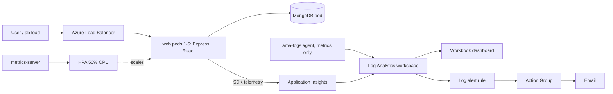

# FoCC Lab 2 - MERN on Azure AKS

Task tracker + visitor counter (React + Express + MongoDB) containerized, autoscaled with HPA and monitored with Azure Monitor.

## Architecture

## Run locally
`docker compose up --build -d`, then open http://localhost:3000

## Build and push (ACR)
`docker build --platform linux/amd64 -t <acr>.azurecr.io/lab2-web:v2 . && docker push <acr>.azurecr.io/lab2-web:v2`

## Deploy to AKS
`kubectl create secret generic appi --from-literal=conn="<app insights connection string>"`, then `kubectl apply -f k8s/`

## Monitoring
Container Insights collects metrics only (`dcr-settings.json`, no raw container logs). Application Insights provides HTTP request count and P95 latency. The alert rule is in `alert.json`.

## Load test
`ab -t 180 -c 100 http://<EXTERNAL-IP>/api/compute`

## Cleanup
`az group delete -n lab2-rg --yes`